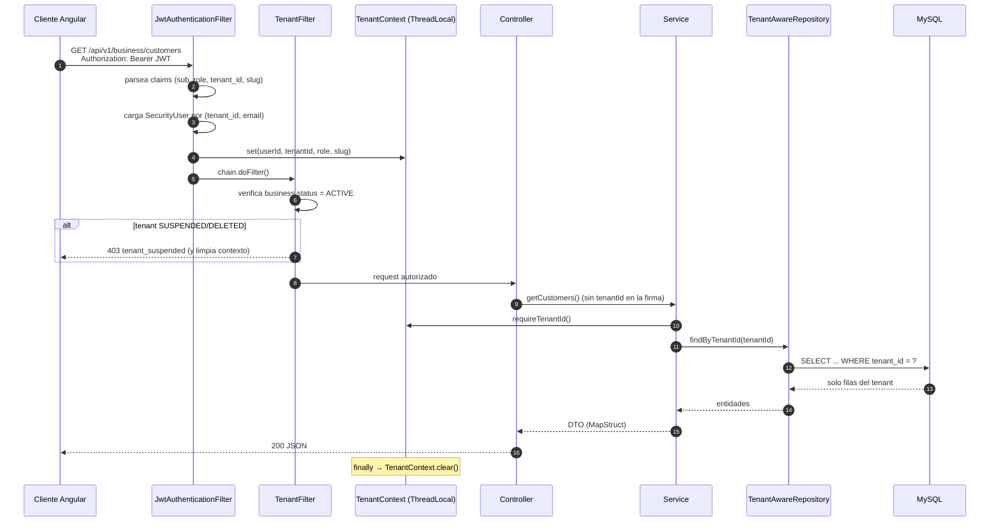
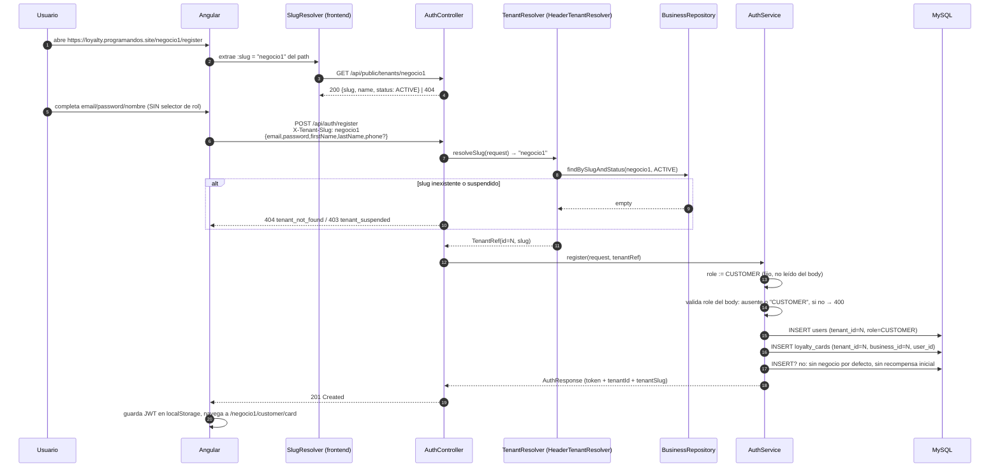

# PLAN — Migración de Loyalty Card a SaaS multi-tenant

| Campo | Valor |
|---|---|
| Repo | `loyalty-app` (Spring Boot 3.5.16 + Angular 17 + MySQL 8) |
| Objetivo | Multi-tenant shared-DB / shared-schema con jerarquía `PLATFORM_ADMIN` → `BUSINESS_ADMIN` → `CUSTOMER` |
| Alcance | R1 = multi-tenant funcional y aislado · R1.5 = canje de recompensas · R2 branding y R3 PWA solo resumidos |
| Presupuesto | Máx. 35 tareas totales / máx. 25 en R1 (este plan v1.1: 35 / 25) |
| Versión | **v1.1** (aprobada v1.0 + 4 ajustes: EP-06 a R1.5, FND-05, decisión de datos en DB-03, R-07 con FND-06) |
| Estado | Documento de arquitectura. No contiene código de la app |

---

## 1. Diagnóstico verificado

### 1.1 Defectos afirmados por el README

| # | Afirmación del README | Veredicto | Evidencia | Severidad |
|---|---|---|---|---|
| R1 | El registro público acepta `role` en el body → mass assignment de rol | **CONFIRMADO** | `AuthDto.java:24-25` (`@NotBlank private String role; // CUSTOMER or BUSINESS_OWNER`), `AuthService.java:44` (`User.Role.valueOf(request.getRole().toUpperCase())`), `AuthService.java:75-84` (crea comercio si el rol es `BUSINESS_OWNER`) | **Crítico** |
| R2 | El cliente se ata al "primer business global", sin aislamiento | **CONFIRMADO** | `AuthService.java:59-74`, en particular `businessRepository.findAll().stream().findFirst()` (`:61-63`); si no hay negocio, `createDefaultBusiness()` (`:110-119`) crea uno con el cliente como `owner_id` | **Crítico** |
| R3 | No existe `frontend/Dockerfile` y Compose lo referencia | **CONFIRMADO** | `docker-compose.yml:53-55` (`build.context: ./frontend`, `dockerfile: Dockerfile`); verificado `Test-Path frontend/Dockerfile` → `False` | **Alto** |
| R4 | No existe `spring-boot-starter-actuator` y el health check apunta a `/actuator/health` | **CONFIRMADO** | `backend/pom.xml:27-110` (no hay actuator); `docker-compose.yml:45-49` (`wget ... /actuator/health`) | **Alto** |
| R5 | `ngx-translate` configurado sin archivos `src/assets/i18n/*.json` | **CONFIRMADO** | `frontend/src/app/app.config.ts:11-13` (carga `./assets/i18n/`), `app.component.ts:14-18` (`translate.use(savedLang)` en bootstrap); `Test-Path frontend/src/assets` → `False` | **Medio** |
| R6 | `environment.prod.ts` apunta a `localhost` | **CONFIRMADO** | `frontend/src/environments/environment.prod.ts:3` (`apiUrl: 'http://localhost:8080/api'`), reemplazado en build de producción por `angular.json:29-40` | **Alto** |

**El README no miente en ninguno de los seis puntos.** Sí omite los defectos de la sección 1.2, que son los más graves para el objetivo multi-tenant.

### 1.2 Defectos adicionales encontrados

| # | Defecto | Evidencia | Severidad |
|---|---|---|---|
| D-01 | **IDOR total en endpoints de admin**: cualquier `BUSINESS_OWNER` puede leer la tarjeta y el QR de un `userId` arbitrario | `AdminController.java:34-37` y `:57-61` reciben `@PathVariable Long userId` y llaman al service sin validar pertenencia; `LoyaltyCardService.java:30-34`, `:36-40` | **Crítico** |
| D-02 | **IDOR de escritura**: cualquier owner agrega sellos a la tarjeta de cualquier cliente del sistema | `AdminController.java:39-46`, `LoyaltyCardService.java:43-45` (`findByUserId` sin filtro de negocio) | **Crítico** |
| D-03 | **Listado y búsqueda de clientes global**: devuelve clientes de todos los comercios, con email, teléfono y QR | `UserRepository.java:16-23` (sin `business`/tenant), `LoyaltyCardService.java:80-90` | **Crítico** |
| D-04 | **Escaneo de QR global**: un owner escanea un QR de otro comercio y le agrega un sello | `LoyaltyCardService.java:73-78` (`userRepository.findByQrCode(qrCode)` sin tenant) | **Crítico** |
| D-05 | **Email único global** en DB, incompatible con "mismo email en 2 tenants" | `schema.sql:18` (`email VARCHAR(255) NOT NULL UNIQUE`), `UserRepository.java:12` (`findByEmail` global), `AuthService.java:40` (`existsByEmail`) | **Alto** |
| D-06 | **Teléfono único global**, mismo problema de identidad por tenant | `schema.sql:22` (`phone VARCHAR(30) UNIQUE`) | **Medio** |
| D-07 | **JWT sin `tenant_id` ni `role`**: el filtro recarga el usuario por email y no hay contexto de tenant posible | `JwtService.java:43-51` (claims vacíos), `JwtAuthenticationFilter.java:44-55`, `SecurityConfig.java:76-80` | **Alto** |
| D-08 | **Modelo de roles incompleto**: no existen `PLATFORM_ADMIN` ni `BUSINESS_ADMIN`, y no hay `tenant_id` en `users` | `User.java:105-107`, `schema.sql:23`, `schema.sql:16-30` | **Alto** |
| D-09 | **No existe operación de canje**: `REDEEMED` y `redeemed_at` existen pero ningún endpoint los usa | `schema.sql:97-99`, `Reward.java:29,65-67`, ausencia de endpoint en `AdminController`/`CustomerController` | **Alto** |
| D-10 | **Errores de negocio devueltos como 500**: "not found" e "invalid QR" salen por el handler genérico de `RuntimeException` | `GlobalExceptionHandler.java:22-26`, `LoyaltyCardService.java:32,38,45,76` | **Medio** |
| D-11 | **CORS con un solo origen y header wildcard**: no soporta la lista que exige el multi-tenant | `SecurityConfig.java:40-41` (`String allowedOrigins`), `:66` (`List.of(allowedOrigins)`), `:68` (`setAllowedHeaders(List.of("*"))`) | **Medio** |
| D-12 | **`BusinessService` carga todas las tarjetas en memoria** para contar clientes (`findAll().stream().filter(...)`) | `BusinessService.java:46-48` | **Medio** |
| D-13 | **Tests que codifican la vulnerabilidad**: hay un test que exige poder registrarse como `BUSINESS_OWNER` | `AuthControllerTest.java:48-62` | **Alto** |
| D-14 | **Duplicación de DTOs en el frontend**: `AuthRequest`/`RegisterRequest`/`AuthResponse` se declaran en `auth.service.ts` y otra vez en `models.ts` | `auth.service.ts:7-28`, `models.ts:1-22` | **Bajo** |
| D-15 | **Assets declarados que no existen**: `angular.json` referencia `src/assets` y `src/favicon.ico`; ninguno existe. El build copia un directorio inexistente y el loader de i18n pide `/assets/i18n/en.json` → 404 | `angular.json:24` y `:71`; `Test-Path` → `False` para ambos; `app.config.ts:12` | **Medio** |
| D-16 | **`register` devuelve 200 en vez de 201** | `AuthController.java:19-23` | **Bajo** |
| D-17 | **Comentario de esquema desactualizado**: dice que Hibernate crea las tablas con `ddl-auto=update`, pero no hay `application.properties`/`yml` y el default de Boot para MySQL es `none` | `schema.sql:1-5` vs ausencia de config; `README.md:120` | **Bajo** |
| D-18 | **Entidad y esquema discrepan**: `Business.description` es `nullable=false` en JPA y `TEXT` nullable en MySQL; el builder no setea `logoUrl` ni `description` | `Business.java:20-21` vs `schema.sql:38`; `Business.java:96-102` | **Bajo** |
| D-19 | **Mapeo dependiente de OSIV + N+1**: los mappers leen `card.getUser()`, `card.getBusiness()`, `stamp.getAddedBy()` fuera de transacción, apoyados en Open Session In View | `LoyaltyCardService.java:92-134`, `BusinessService.java:45-61` | **Medio** |
| D-20 | **Secretos hardcodeados en Compose** y `schema.sql` montado como init script (doble fuente de verdad del esquema) | `docker-compose.yml:11-14`, `:19`, `:40-42` | **Alto** |
| D-21 | **Sin `.dockerignore` en frontend**: el contexto de build incluye `node_modules` (~1 GB) | `docker-compose.yml:53-55`, ausencia de `frontend/.dockerignore` | **Bajo** |
| D-22 | **Sin paginación** en clientes, recompensas ni sellos; listas completas al cliente | `AdminController.java:24-32`, `LoyaltyCardService.java:93-115` | **Bajo** |
| D-23 | **Basura versionada**: `target/maven-status/**`, `.idea/**`, `project-snapshot.json` (contiene rutas locales `D:\TPS 2026\...`), y un árbol duplicado en la raíz `src/main/java/com/loyalty/repository/*.java` que no pertenece a ningún módulo | `git ls-files`; `project-snapshot.json:5-6`; `src/main/java/com/loyalty/repository/BusinessRepository.java:1-12` | **Medio** |
| D-24 | **Sin Flyway/Liquibase**: el esquema se aplica a mano y no hay historial, checksum ni rollback | `README.md:282`, `schema.sql:1-5` | **Alto** |
| D-25 | **Bootstrap de `PLATFORM_ADMIN` no definido**: no hay ninguna vía para crear el primer administrador global sin volver al mass assignment | `AuthService.java:38-92` (solo crea CUSTOMER/BUSINESS_OWNER) | **Alto** (gap de diseño, no bug) |

### 1.3 Resumen de severidad

| Severidad | Cantidad | IDs |
|---|---|---|
| Crítico | 6 | R1, R2, D-01, D-02, D-03, D-04 |
| Alto | 11 | R3, R4, R6, D-05, D-07, D-08, D-09, D-13, D-20, D-24, D-25 |
| Medio | 10 | R5, D-06, D-10, D-11, D-12, D-15, D-19, D-23 y 2 menores agrupados |
| Bajo | 6 | D-14, D-16, D-17, D-18, D-21, D-22 |

> Regla de prioridad aplicada al plan: primero se cierran las fugas (D-01…D-04, R1, R2), después se agregan features (platform, canje).

---

## 2. Arquitectura objetivo

### 2.1 Componentes

```mermaid
flowchart LR
    subgraph Browser["Navegador"]
        A["Angular 17<br/>/:slug/... · :slug desde path"]
        LS[("localStorage<br/>JWT + user")]
    end

    subgraph Edge["Nginx (frontend)"]
        N["SPA fallback + proxy /api"]
    end

    subgraph API["Spring Boot 3.5 / Java 21"]
        F1["JwtAuthenticationFilter<br/>valida JWT → SecurityContext"]
        F2["TenantFilter<br/>JWT → TenantContext · header → slug (público)"]
        F3["TenantStatusGuard<br/>ACTIVE / SUSPENDED / DELETED"]
        C["Controllers<br/>/api/auth · /api/public<br/>/api/v1/platform · /api/v1/business<br/>/api/v1/customer · /api/v1/rewards"]
        S["Services<br/>regla de negocio + TenantContext"]
        R["TenantAwareRepository<br/>toda query lleva tenant_id"]
        M[("MySQL 8<br/>shared schema<br/>tenant_id en cada tabla")]
    end

    A --> N --> F1 --> F2 --> F3 --> C --> S --> R --> M
    LS -.-> A
```



### 2.2 Request autenticado (JWT → TenantContext → Repository → DB)



Reglas del flujo:

- El `tenant_id` del request autenticado **solo** puede venir del claim `tenant_id` del JWT. Un `tenant_id`, `businessId` o `slug` en body/query/path se ignora o se rechaza con 400.
- Si el request trae `X-Tenant-Slug` y no coincide con el slug del JWT → 403 `tenant_mismatch` (defensa contra confusión de tenant en el frontend).
- `PLATFORM_ADMIN` no tiene tenant: los endpoints de negocio (`/api/v1/business/**`, `/api/v1/customer/**`, `/api/v1/rewards/**`) le responden 403 por matcher de rol, no por lógica de servicio.
- Excepción explícita y acotada: `/api/v1/platform/**` recibe `{businessId}` en la URL porque ese es el trabajo del `PLATFORM_ADMIN`.

### 2.3 Registro público (path → X-Tenant-Slug → business → user con tenant_id)



### 2.4 Por qué `TenantAwareRepository` evita fugas

**Primero, elimina la posibilidad de escribir la query equivocada.** Hoy cualquier service puede llamar `findById(userId)` y obtener la tarjeta de otro comercio (`LoyaltyCardService.java:31,44`). La pieza central del rediseño es una interfaz base `@NoRepositoryBean TenantAwareRepository<T extends TenantOwned, ID>` que **no hereda** los métodos peligrosos en su forma usable: expone `findByIdAndTenantId(id, tenantId)`, `findAllByTenantId(tenantId, Pageable)` y `countByTenantId(tenantId)`, y los repositorios de recursos tenant-scoped (`LoyaltyCardRepository`, `StampRepository`, `RewardRepository`, `UserRepository` para clientes) se declaran sobre esa base. Un método que no recibe `tenantId` simplemente no existe en el tipo, así que un `service` nuevo no puede olvidarlo sin que el compilador lo frene.

**Segundo, el `tenantId` no lo elige el código que llama: lo impone el contexto.** `TenantContext` es un `ThreadLocal` poblado por `JwtAuthenticationFilter` a partir del claim firmado, y limpiado en un `finally` del `TenantFilter`. Los services llaman `TenantContext.requireTenantId()` en la primera línea; si el contexto está vacío (request anónimo, job, test mal armado) se lanza `MissingTenantContextException` y el request muere con 500/401 en lugar de ejecutar una query global. El controller nunca recibe `tenantId` como parámetro, por lo que no hay superficie para inyectarlo desde body o URL.

**Tercero, hay redes de seguridad por debajo del código.** `TenantGuard.requireOwned(resource, tenantId)` responde **404** (no 403) cuando el recurso pertenece a otro tenant, para no filtrar la existencia del ID. En la base, `CHECK (tenant_id = business_id)` en `loyalty_cards` y FKs compuestas `(loyalty_card_id, tenant_id) → loyalty_cards(id, tenant_id)` en `stamps` y `rewards` hacen **imposible** que una fila hija quede con un tenant distinto al de su padre, incluso si un bug de aplicación lo intenta. Y una suite de tests IDOR por endpoint (TST-01) recorre el caso "token de A contra recurso de B" exigiendo 404. Las tres capas juntas — tipo, contexto y constraint — son lo que hace que el aislamiento no dependa de la disciplina de quien escribe el próximo service.

---

## 3. Modelo de datos objetivo

Convenciones: `NUEVO` = columna/tabla que no existe hoy; `MOD` = columna existente que cambia; tipos MySQL 8, `utf8mb4`, `InnoDB`. `businesses` **es** la tabla tenant (no se crea `tenants`).

### 3.1 `businesses` (tenant)

| Columna | Tipo | Null | Cambio | Notas |
|---|---|---|---|---|
| `id` | `BIGINT` PK AI | no | — | Es el `tenant_id` del sistema |
| `name` | `VARCHAR(200)` | no | — | |
| `slug` | `VARCHAR(80)` | no | **NUEVO** | `UNIQUE uk_businesses_slug`; `CHECK slug REGEXP '^[a-z0-9]+(-[a-z0-9]+)*$'`; inmutable post-creación |
| `description` | `TEXT` | sí | MOD | Se alinea con la entidad (`Business.java:20-21` la declara NOT NULL) |
| `logo_url` | `VARCHAR(500)` | sí | — | R2 lo usa para branding |
| `color_primary` | `CHAR(7)` | sí | **NUEVO** | `#RRGGBB`; R2 |
| `color_secondary` | `CHAR(7)` | sí | **NUEVO** | `#RRGGBB`; R2 |
| `stamps_required` | `INT` | no | — | default 10 |
| `reward_description` | `VARCHAR(500)` | no | — | |
| `status` | `VARCHAR(16)` | no | **NUEVO** | `ACTIVE` / `SUSPENDED` / `DELETED`, default `ACTIVE`; `INDEX idx_businesses_status` |
| `owner_id` | `BIGINT` | sí | MOD | Hoy `NOT NULL` + `ON DELETE CASCADE` (`schema.sql:42-46`). Pasa a **nullable** y `ON DELETE SET NULL`: el creador no es el dueño del tenant. La autorización **no** usa esta columna |
| `created_at` | `DATETIME` | no | — | |
| `deleted_at` | `DATETIME` | sí | **NUEVO** | Soft delete **solo acá** |

Índices/FKs: `uk_businesses_slug (slug)`, `idx_businesses_status (status)`, `fk_business_owner (owner_id) → users(id) ON DELETE SET NULL`.

### 3.2 `users`

| Columna | Tipo | Null | Cambio | Notas |
|---|---|---|---|---|
| `id` | `BIGINT` PK AI | no | — | |
| `tenant_id` | `BIGINT` | sí | **NUEVO** | `FK → businesses(id) ON DELETE RESTRICT`. `NULL` **solo** para `PLATFORM_ADMIN` |
| `tenant_key` | `BIGINT GENERATED ALWAYS AS (IFNULL(tenant_id,0)) STORED` | no | **NUEVO** | Necesario porque MySQL permite emails duplicados cuando `tenant_id IS NULL` en un UNIQUE compuesto (NULLs distintos). Con la columna generada, el admin global también queda cubierto |
| `email` | `VARCHAR(255)` | no | MOD | Se quita el `UNIQUE` global (`schema.sql:18`) |
| `password` | `VARCHAR(255)` | no | — | BCrypt |
| `first_name` | `VARCHAR(100)` | no | — | |
| `last_name` | `VARCHAR(100)` | no | — | |
| `phone` | `VARCHAR(30)` | sí | MOD | Se quita `UNIQUE` global (`schema.sql:22`); unicidad por tenant |
| `role` | `VARCHAR(32)` | no | MOD | De `ENUM('CUSTOMER','BUSINESS_OWNER')` a `VARCHAR` con `PLATFORM_ADMIN` / `BUSINESS_ADMIN` / `CUSTOMER` + `CHECK` |
| `qr_code` | `VARCHAR(64)` | no | — | `UNIQUE` global a propósito: es un token opaco; la búsqueda por QR **igual** filtra por tenant |
| `created_at` | `DATETIME` | no | — | |

Índices/constraints:
- `UNIQUE uk_users_tenant_email (tenant_key, email)`
- `UNIQUE uk_users_tenant_phone (tenant_key, phone)`
- `INDEX idx_users_tenant_role (tenant_id, role)`, `UNIQUE uk_users_qr (qr_code)`
- `CHECK ck_users_tenant_role`: `(role = 'PLATFORM_ADMIN' AND tenant_id IS NULL) OR (role IN ('BUSINESS_ADMIN','CUSTOMER') AND tenant_id IS NOT NULL)`

### 3.3 `loyalty_cards`

| Columna | Tipo | Null | Cambio | Notas |
|---|---|---|---|---|
| `id` | `BIGINT` PK AI | no | — | |
| `tenant_id` | `BIGINT` | no | **NUEVO** | Redundante por decisión; `= business_id` |
| `user_id` | `BIGINT` | no | — | |
| `business_id` | `BIGINT` | no | — | |
| `total_stamps` | `INT` | no | — | copiado de `businesses.stamps_required` al crear |
| `current_stamps` | `INT` | no | — | |
| `completed_cards` | `INT` | no | — | |
| `status` | `ENUM('ACTIVE','COMPLETED','REWARD_PENDING')` | no | — | Al canjear la última recompensa disponible vuelve a `ACTIVE` |
| `created_at` / `updated_at` | `DATETIME` | no | — | |

Índices/constraints:
- `UNIQUE uk_cards_tenant_user (tenant_id, user_id)` — reemplaza `user_id UNIQUE` (`schema.sql:54`). Un customer es per-tenant, así que sigue habiendo una tarjeta por (tenant, usuario), pero ya no bloquea el mismo email en dos negocios.
- `UNIQUE uk_cards_id_tenant (id, tenant_id)` — soporta las FKs compuestas de hijos.
- `CHECK ck_cards_tenant_business (tenant_id = business_id)`
- `INDEX idx_cards_tenant_business (tenant_id, business_id, status)`
- `FK user_id → users(id) ON DELETE CASCADE`, `FK business_id → businesses(id) ON DELETE RESTRICT`

### 3.4 `stamps`

| Columna | Tipo | Null | Cambio | Notas |
|---|---|---|---|---|
| `id` | `BIGINT` PK AI | no | — | |
| `tenant_id` | `BIGINT` | no | **NUEVO** | Redundante + FK compuesta |
| `loyalty_card_id` | `BIGINT` | no | — | |
| `added_by_id` | `BIGINT` | no | — | debe ser `BUSINESS_ADMIN` del mismo tenant (validado en service) |
| `note` | `VARCHAR(300)` | sí | — | |
| `created_at` | `DATETIME` | no | — | |

Índices/constraints:
- `FK (loyalty_card_id, tenant_id) → loyalty_cards(id, tenant_id)` — imposibilita sello cruzado
- `FK added_by_id → users(id) ON DELETE RESTRICT`
- `INDEX idx_stamps_tenant_created (tenant_id, created_at)`, `INDEX idx_stamps_card (loyalty_card_id)`

### 3.5 `rewards`

| Columna | Tipo | Null | Cambio | Notas |
|---|---|---|---|---|
| `id` | `BIGINT` PK AI | no | — | |
| `tenant_id` | `BIGINT` | no | **NUEVO** | Redundante + FK compuesta |
| `loyalty_card_id` | `BIGINT` | no | — | |
| `description` | `VARCHAR(500)` | no | — | copiada de `businesses.reward_description` |
| `status` | `ENUM('AVAILABLE','REDEEMED')` | no | — | transición única `AVAILABLE → REDEEMED` |
| `earned_at` | `DATETIME` | no | — | |
| `redeemed_at` | `DATETIME` | sí | — | **ya existe** (`schema.sql:99`); se completa en el canje |
| `redeemed_by_id` | `BIGINT` | sí | **NUEVO** | auditoría básica: quién canjeó. `FK → users(id) ON DELETE SET NULL` |

Índices/constraints:
- `FK (loyalty_card_id, tenant_id) → loyalty_cards(id, tenant_id)`
- `INDEX idx_rewards_tenant_status (tenant_id, status)`, `INDEX idx_rewards_card (loyalty_card_id)`

### 3.6 `rewards_redeemed`

**N/A.** No se crea tabla separada. El canje es una transición de estado de `rewards` (`status`, `redeemed_at`, `redeemed_by_id`), sin historial múltiple ni reversa. Una tabla de eventos sería sobre-ingeniería para un MVP y obligaría a mantener dos fuentes de verdad.

---

## 4. Migraciones Flyway

Ubicación: `backend/src/main/resources/db/migration/`. Rollbacks en `backend/src/main/resources/db/rollback/` (fuera de `flyway.locations`, para que nunca se ejecuten automáticamente). Flyway Community no tiene `undo`: el rollback es manual y documentado.

Configuración: `spring.flyway.enabled=true`, `baseline-on-migrate=true`, `baseline-version=0`. Motivo: las bases de desarrollo ya tienen las 5 tablas creadas por `schema.sql`; con baseline 0 el historial arranca vacío y V1 se aplica igual porque es idempotente (`CREATE TABLE IF NOT EXISTS`).

> **v1.1 — Escenario de datos.** R1 se ejecuta asumiendo **DB descartable** (portfolio, sin datos a preservar). En ese caso V4 se reduce a: rol `BUSINESS_OWNER → BUSINESS_ADMIN`, `slug` derivado del nombre, `tenant_id` desde `owner_id`/tarjeta y `tenant_id = business_id` en hijos; no hay tenant `legacy`, no hay normalización de `redeemed_at` y no se ejecutan los pasos 4–5. **DB-03 baja a 1 pt** y absorbe V5 en la misma sesión. Si el usuario confirma que hay datos a preservar, se reabre como DB-03 (3 pts) + DB-04 (2 pts) con el procedimiento completo de abajo; eso lleva R1 a 26 tareas y **requiere aprobación explícita** por exceder el tope. Confirmación pendiente → ver TODO-01.

**Antes de V1: `mysqldump --single-transaction --routines loyalty_db > backup_pre_flyway.sql`.** Sin ese dump, ningún rollback es confiable.

### V1__baseline.sql

- **Qué hace:** congela el esquema actual tal cual (`schema.sql` sin `CREATE DATABASE`, sin `USE`, manteniendo `IF NOT EXISTS`, ENUM de 2 roles, índices y FKs). No transforma datos.
- **Datos:** ninguno.
- **Rollback (`V1__baseline.down.sql`):** `DROP TABLE IF EXISTS rewards, stamps, loyalty_cards, businesses, users;` (solo entornos descartables).
- **Verificación:** `SELECT COUNT(*) FROM information_schema.tables WHERE table_schema = DATABASE();` → 5. Comparar `SELECT COUNT(*)` de las 5 tablas contra el dump previo (deben ser idénticos). `SELECT version, success FROM flyway_schema_history;` → 1 fila, `success=1`.

### V2__tenant_businesses_users.sql

- **Qué hace:**
  - `businesses`: `ADD slug VARCHAR(80) NULL`, `ADD status VARCHAR(16) NOT NULL DEFAULT 'ACTIVE'`, `ADD color_primary CHAR(7) NULL`, `ADD color_secondary CHAR(7) NULL`, `ADD deleted_at DATETIME NULL`; `MODIFY owner_id BIGINT NULL`; drop `fk_business_owner` + recreate `ON DELETE SET NULL`; `ADD INDEX idx_businesses_status`.
  - `users`: `ADD tenant_id BIGINT NULL`, `ADD tenant_key BIGINT AS (IFNULL(tenant_id,0)) STORED`; `DROP INDEX email`, `ADD UNIQUE uk_users_tenant_email (tenant_key, email)`; `DROP INDEX phone`, `ADD UNIQUE uk_users_tenant_phone (tenant_key, phone)`; `MODIFY role VARCHAR(32) NOT NULL DEFAULT 'CUSTOMER'`; `ADD INDEX idx_users_tenant_role`; `ADD CONSTRAINT fk_users_tenant FOREIGN KEY (tenant_id) REFERENCES businesses(id) ON DELETE RESTRICT`.
  - Conversión de ENUM a VARCHAR en vez de migrar ENUM: evita dos rebuilds de tabla, alinea con `@Enumerated(STRING)` (`User.java:35-37`) y permite `CHECK` explícito.
- **Datos:** ninguno (todo nullable).
- **Rollback:** `ALTER TABLE users DROP FOREIGN KEY fk_users_tenant, DROP INDEX uk_users_tenant_email, DROP INDEX uk_users_tenant_phone, DROP COLUMN tenant_key, DROP COLUMN tenant_id, MODIFY role ENUM('CUSTOMER','BUSINESS_OWNER') NOT NULL DEFAULT 'CUSTOMER', ADD UNIQUE (email), ADD UNIQUE (phone);` + reversa equivalente en `businesses`. Requiere que no haya roles nuevos aún.
- **Verificación:** `SHOW CREATE TABLE users` contiene `tenant_key` y los dos UNIQUE compuestos; `SELECT COUNT(*) FROM users;` igual al backup; `SELECT COUNT(*) FROM users WHERE role NOT IN ('CUSTOMER','BUSINESS_OWNER');` → 0.

### V3__tenant_child_tables.sql

- **Qué hace:** `loyalty_cards`, `stamps`, `rewards`: `ADD tenant_id BIGINT NULL`; `rewards ADD redeemed_by_id BIGINT NULL` + FK `ON DELETE SET NULL`; índices `idx_cards_tenant_business`, `idx_stamps_tenant_created`, `idx_rewards_tenant_status`; `UNIQUE uk_cards_id_tenant (id, tenant_id)`.
- **Datos:** ninguno (nullable).
- **Rollback:** drop de las columnas/índices/FK agregados.
- **Verificación:** columnas presentes (`information_schema.columns`), `SELECT COUNT(*)` de las 3 tablas igual al backup, `SELECT COUNT(*) FROM rewards WHERE status='REDEEMED' AND redeemed_at IS NULL;` → valor esperado registrado antes (se corrige en V4).

### V4__backfill_tenants.sql

- **Qué hace, en este orden (todo en una transacción):**
  1. **Slug por negocio:** `UPDATE businesses SET slug = CONCAT(REGEXP_REPLACE(REGEXP_REPLACE(LOWER(name),'[^a-z0-9]+','-'),'^-|-$',''),'-',id) WHERE slug IS NULL;` (el sufijo `-id` garantiza unicidad sin coordination).
  2. **Rol:** `UPDATE users SET role='BUSINESS_ADMIN' WHERE role='BUSINESS_OWNER';`
  3. **Tenant de admins:** `UPDATE users u JOIN businesses b ON b.owner_id = u.id SET u.tenant_id = b.id WHERE u.role='BUSINESS_ADMIN' AND u.tenant_id IS NULL;`
  4. **Tenant de customers con tarjeta:** `UPDATE users u JOIN loyalty_cards c ON c.user_id=u.id SET u.tenant_id=c.business_id WHERE u.role='CUSTOMER' AND u.tenant_id IS NULL;`
  5. **Huérfanos:** si quedan `CUSTOMER` con `tenant_id IS NULL` (usuarios sin tarjeta), insertar un tenant contenedor `('Legacy Import','legacy','ACTIVE',10,'Legacy data',NULL)` y asignarlos ahí. Se documenta como deuda explícita: no se borran usuarios ni se inventan tarjetas.
  6. **Hijos:** `UPDATE loyalty_cards SET tenant_id=business_id WHERE tenant_id IS NULL;` `UPDATE stamps s JOIN loyalty_cards c ON c.id=s.loyalty_card_id SET s.tenant_id=c.tenant_id;` idem `rewards`; `UPDATE rewards SET redeemed_at=earned_at WHERE status='REDEEMED' AND redeemed_at IS NULL;`
- **Datos:** transforma `BUSINESS_OWNER → BUSINESS_ADMIN`, asigna tenant a todos los usuarios, tarjetas, sellos y recompensas, y normaliza `redeemed_at`.
- **Rollback:** `UPDATE rewards SET redeemed_at=NULL WHERE status='REDEEMED';` `UPDATE stamps SET tenant_id=NULL;` `UPDATE rewards SET tenant_id=NULL;` `UPDATE loyalty_cards SET tenant_id=NULL;` `UPDATE users SET tenant_id=NULL;` `UPDATE users SET role='BUSINESS_OWNER' WHERE role='BUSINESS_ADMIN';` `UPDATE businesses SET slug=NULL;` borrar el tenant `legacy` solo si quedó vacío. **Solo válido si no se crearon datos nuevos después de V4**; si los hubo, restaurar el dump.
- **Verificación (todas deben devolver 0 filas / 0):**
```sql
SELECT COUNT(*) FROM users WHERE role='BUSINESS_OWNER';
SELECT COUNT(*) FROM users WHERE role<>'PLATFORM_ADMIN' AND tenant_id IS NULL;
SELECT COUNT(*) FROM businesses WHERE slug IS NULL;
SELECT slug FROM businesses GROUP BY slug HAVING COUNT(*) > 1;
SELECT COUNT(*) FROM loyalty_cards WHERE tenant_id <> business_id;
SELECT COUNT(*) FROM stamps s JOIN loyalty_cards c ON c.id=s.loyalty_card_id WHERE s.tenant_id<>c.tenant_id;
SELECT COUNT(*) FROM rewards r JOIN loyalty_cards c ON c.id=r.loyalty_card_id WHERE r.tenant_id<>c.tenant_id;
SELECT tenant_key, email FROM users GROUP BY tenant_key, email HAVING COUNT(*) > 1;
SELECT COUNT(*) FROM loyalty_cards c LEFT JOIN users u ON u.id=c.user_id WHERE u.tenant_id<>c.tenant_id;
```

### V5__tenant_constraints.sql

- **Qué hace:** `MODIFY tenant_id BIGINT NOT NULL` en `loyalty_cards`, `stamps`, `rewards`; `MODIFY businesses.slug VARCHAR(80) NOT NULL` + `UNIQUE uk_businesses_slug` + `CHECK ck_businesses_slug`; `CHECK ck_cards_tenant_business (tenant_id = business_id)`; drop `fk_card_user`/`fk_card_business`/`fk_stamp_card`/`fk_reward_card` viejas y recrear: `stamps FK (loyalty_card_id, tenant_id) → loyalty_cards(id, tenant_id)`, `rewards` idem, `loyalty_cards (tenant_id,user_id) UNIQUE`; `CHECK ck_users_tenant_role`.
- **Datos:** ninguno; solo valida lo que V4 dejó consistente.
- **Rollback:** drop de checks, FKs compuestas y UNIQUE nuevos; recreate FKs simples originales; `MODIFY tenant_id ... NULL`.
- **Verificación:** `SHOW CREATE TABLE` de las 5 tablas contiene los checks y FKs compuestas. Prueba negativa en DB de scratch: `INSERT INTO stamps (tenant_id, loyalty_card_id, added_by_id) VALUES (999, <card de otro tenant>, <admin>);` → error `errno 1452`.

### 4.1 Prueba global de que las migraciones no rompen datos

1. `mysqldump` previo (obligatorio).
2. Restaurar ese dump en una base scratch → `spring.flyway.baseline-on-migrate=true` → arrancar la app → V1..V5 aplicadas sin error.
3. Correr el bloque de verificación de V4 + `SELECT COUNT(*)` de las 5 tablas; comparar con el dump.
4. Login real con un `BUSINESS_ADMIN` migrado y con un `CUSTOMER` migrado (`curl` con `X-Tenant-Slug`), y `GET /api/v1/business/me` devolviendo el negocio correcto.
5. `flyway_schema_history`: 5 filas, todas `success=1`, `installed_on` creciente.
6. Los tests unitarios corren con `spring.flyway.enabled=false` y `ddl-auto=create-drop` sobre H2 (sintaxis MySQL de V1..V5 no es portable a H2). La cobertura real de las migraciones la aporta **FND-06** (`scripts/verify-migrations.sh` + CI con MySQL 8 en Docker): ver riesgo R-07.

---

## 5. Contratos de API

Convenciones: rol en MAYÚSCULAS = `@PreAuthorize` + matcher; "tenant" = `TenantContext` (claim del JWT). Errores comunes: **400** validación, **401** token ausente/inválido, **403** rol incorrecto / tenant suspendido / `X-Tenant-Slug` no coincide, **404** recurso inexistente **o de otro tenant** (mismo código, sin filtrar existencia), **409** conflicto de estado, **500** solo errores no previstos.

### 5.1 Auth (`/api/auth/*`, público)

| Método | Ruta | Estado | Rol | Request (validaciones) | Response | Errores |
|---|---|---|---|---|---|---|
| POST | `/api/auth/register` | **MOD** | público | Header `X-Tenant-Slug` obligatorio. Body: `email` (`@Email`), `password` (`@Size(min=6)`), `firstName`, `lastName` (`@NotBlank`), `phone` opcional, `role` opcional **solo** `"CUSTOMER"` (cualquier otro valor → 400; no se acepta `BUSINESS_ADMIN`/`PLATFORM_ADMIN`) | `201` `{token,email,firstName,lastName,role:"CUSTOMER",userId,tenantId,tenantSlug}` | 400 rol inválido / validación · 403 tenant suspendido · 404 slug inexistente · 409 email ya registrado en el tenant |
| POST | `/api/auth/login` | **MOD** | público | Header `X-Tenant-Slug` **opcional**: presente → usuario del tenant (`BUSINESS_ADMIN`/`CUSTOMER`); ausente → solo `PLATFORM_ADMIN` (`tenant_id IS NULL`). Body: `email`, `password` | `200` `AuthResponse` (mismos campos) | 401 credenciales · 403 tenant suspendido o rol incompatible con el modo de login · 404 slug inexistente |
| GET | `/api/public/tenants/{slug}` | **NUEVO** | público | path `slug` (`^[a-z0-9-]{3,80}$`) | `200` `{slug,name,status}` | 400 formato · 404 inexistente |

> `GET /api/public/tenants/{slug}` es el único endpoint nuevo que no está en el README original. Es necesario para que el frontend valide el slug antes de mostrar el formulario; no expone branding en R1.

### 5.2 Platform (`/api/v1/platform/*`, solo `PLATFORM_ADMIN`, `tenant_id = NULL`)

| Método | Ruta | Estado | Request | Response | Errores |
|---|---|---|---|---|---|
| POST | `/api/v1/platform/businesses` | **NUEVO** | `{name @NotBlank(2..200), slug @Pattern ^[a-z0-9]+(-[a-z0-9]+)*$, description?, stampsRequired? @Min(1) @Max(100), rewardDescription?}` | `201 BusinessResponse` `{id,slug,name,status,createdAt}` | 400 · 409 slug tomado |
| GET | `/api/v1/platform/businesses` | **NUEVO** | query `status?`, `q?`, `page=0`, `size=20` | `200 Page<BusinessSummary>` `{content[],totalElements,page,size}` | 400 page/size inválidos |
| GET | `/api/v1/platform/businesses/{id}` | **NUEVO** | path `id` | `200 BusinessResponse` (+ `totalCustomers`, `totalAdmins`) | 404 |
| PATCH | `/api/v1/platform/businesses/{id}/status` | **NUEVO** | `{status: ACTIVE\|SUSPENDED}` | `200 BusinessResponse` | 400 status inválido · 404 · 409 reactivar un `DELETED` |
| DELETE | `/api/v1/platform/businesses/{id}` | **NUEVO** | path `id` | `204` (soft delete: `status=DELETED`, `deleted_at=now`) | 404 · 409 ya eliminado |
| POST | `/api/v1/platform/businesses/{id}/admins` | **NUEVO** | `{email @Email, password @Size(min=6), firstName, lastName, phone?}` | `201` `{userId,email,role:"BUSINESS_ADMIN",tenantId}` | 400 · 404 business · 409 email ya existe en el tenant |
| GET | `/api/v1/platform/businesses/{id}/admins` | **NUEVO** | path `id` | `200 List<AdminSummary>` `{userId,email,firstName,lastName,createdAt}` | 404 |

Restricciones duras: ningún endpoint de platform agrega sellos, canjea recompensas ni consulta tarjetas. `POST /api/v1/platform/businesses` **no** crea un admin automáticamente (paso separado y explícito).

### 5.3 Business (`/api/v1/business/*`, solo `BUSINESS_ADMIN`, tenant del JWT)

| Método | Ruta | Estado | Request | Response | Errores |
|---|---|---|---|---|---|
| GET | `/api/v1/business/me` | **NUEVO** (reemplaza `GET /api/admin/business`) | — | `200 BusinessResponse` `{id,slug,name,description,logoUrl,stampsRequired,rewardDescription,status,totalCustomers,createdAt}` | 404 si el admin no tiene tenant (dato corrupto) |
| PUT | `/api/v1/business/me` | **NUEVO** (reemplaza `PUT /api/admin/business`) | `{name?, description?, logoUrl? @Size(max=500), stampsRequired? @Min(1) @Max(100), rewardDescription? @Size(max=500)}` — solo campos no nulos | `200 BusinessResponse` | 400 validación |
| GET | `/api/v1/business/customers` | **NUEVO** (reemplaza `GET /api/admin/customers` y `/search`) | query `q?`, `page=0`, `size=20` | `200 Page<CustomerSummary>` (solo `role=CUSTOMER` del tenant) | 400 |
| GET | `/api/v1/business/customers/{userId}` | **NUEVO** | path `userId` | `200 CustomerSummary` | 404 si es de otro tenant o no es CUSTOMER |
| GET | `/api/v1/business/customers/{userId}/card` | **NUEVO** (reemplaza `GET /api/admin/customers/{userId}/card`) | path | `200 LoyaltyCardResponse` | 404 cross-tenant |
| GET | `/api/v1/business/customers/{userId}/qr` | **NUEVO** (reemplaza `GET /api/admin/customers/{userId}/qr`) | path | `200 {qrCode:"data:image/png;base64,..."}` | 404 cross-tenant |
| POST | `/api/v1/business/stamps` | **NUEVO** (reemplaza `POST /api/admin/stamps`) | `{userId @NotNull, note? @Size(max=300)}` | `200 LoyaltyCardResponse` (sellos, estado, recompensas) | 400 · 404 cross-tenant · 409 tarjeta no `ACTIVE`/`REWARD_PENDING` |
| POST | `/api/v1/business/stamps/scan` | **NUEVO** (reemplaza `POST /api/admin/stamps/scan`) | `{qrCode @NotBlank, note?}` | `200 LoyaltyCardResponse` | 400 · 404 QR inexistente **o de otro tenant** |

### 5.4 Customer (`/api/v1/customer/*`, solo `CUSTOMER`)

| Método | Ruta | Estado | Request | Response | Errores |
|---|---|---|---|---|---|
| GET | `/api/v1/customer/card` | **NUEVO** (reemplaza `GET /api/customer/card`) | — (usuario y tenant del JWT) | `200 LoyaltyCardResponse` | 404 sin tarjeta en el tenant |
| GET | `/api/v1/customer/qr` | **NUEVO** (reemplaza `GET /api/customer/qr`) | — | `200 text/plain` data URI PNG | 404 |

### 5.5 Rewards (`/api/v1/rewards/*`, solo `BUSINESS_ADMIN`)

| Método | Ruta | Estado | Request | Response | Errores |
|---|---|---|---|---|---|
| GET | `/api/v1/rewards` | **NUEVO** | query `status?=AVAILABLE\|REDEEMED`, `cardId?`, `page`, `size` | `200 Page<RewardResponse>` `{id,cardId,customerName,description,status,earnedAt,redeemedAt}` | 400 |
| POST | `/api/v1/rewards/{id}/redeem` | **NUEVO** | path `id` (sin body) | `200 RewardResponse` `{id,status:"REDEEMED",redeemedAt,redeemedBy}` | 404 cross-tenant · 409 ya canjeada · 403 platform admin |

Regla transaccional del canje: `UPDATE rewards SET status='REDEEMED', redeemed_at=NOW(), redeemed_by_id=:adminId WHERE id=:id AND tenant_id=:tenant AND status='AVAILABLE'`; si `affectedRows=0` → 409 (evita doble canje concurrente sin `@Version`). Si la tarjeta no tiene más recompensas `AVAILABLE`, `loyalty_cards.status` pasa a `ACTIVE`.

### 5.6 Endpoints eliminados

| Endpoint actual | Reemplazo | Motivo |
|---|---|---|
| `GET/PUT /api/admin/business` (`BusinessController.java:11`) | `GET/PUT /api/v1/business/me` | El path `/admin` no distingue platform de business; el lookup por `owner_id` (`BusinessService.java:23`) desaparece |
| `GET /api/admin/customers`, `/search` (`AdminController.java:24-32`) | `GET /api/v1/business/customers?q=` | Fuga global + falta paginación |
| `GET /api/admin/customers/{userId}/card`, `/qr` (`AdminController.java:34-37,57-61`) | `GET /api/v1/business/customers/{userId}/card`, `/qr` | IDOR |
| `POST /api/admin/stamps`, `/stamps/scan` (`AdminController.java:39-55`) | `POST /api/v1/business/stamps`, `/stamps/scan` | IDOR de escritura |
| `GET /api/customer/card`, `/qr` (`CustomerController.java:20-28`) | `GET /api/v1/customer/card`, `/qr` | Versionado consistente |
| Campo `role` en `POST /api/auth/register` (`AuthDto.java:24-25`) | eliminado | Mass assignment |

Los mappings viejos se **eliminan** (no se dejan como alias): el frontend se despliega junto (Fase H) y un alias perpetúa la superficie de ataque. Post-deploy, un request a `/api/admin/**` responde 404.

---

## 6. Plan de tareas — Release 1 (25 tareas)

Puntos permitidos: 1/2/3/5. DoD siempre verificable con un comando, un test o un status HTTP.

### Fase A — Fundaciones (6 tareas · 17 pts)

Orden de ejecución de la fase: **FND-01 → FND-02 → FND-05 → FND-03 → FND-04 → FND-06**.

| ID | Título | Dep | Archivos | Definition of Done | Riesgo | Pts |
|---|---|---|---|---|---|---|
| **FND-01** | Flyway + `V1__baseline.sql` desde `schema.sql` | — | `backend/pom.xml`, `backend/src/main/resources/application.yml` (nuevo, mínimo: datasource por env + `spring.flyway.*`), `db/migration/V1__baseline.sql`, `db/rollback/V1__baseline.down.sql`, `backend/src/test/resources/application-test.properties` (`spring.flyway.enabled=false`), `docker-compose.yml` (quitar mount de `schema.sql` en `:19`) | `flyway_schema_history` tiene 1 fila `success=1` en base existente **y** en base vacía; `information_schema.tables` = 5; counts de las 5 tablas iguales al dump previo; `mvn -pl backend test` verde con Flyway apagado en test | Medio | 3 |
| **FND-02** | Java 24 → Java 21 (LTS) en POMs y Dockerfile | — | `pom.xml:17-18`, `backend/pom.xml:21`, `backend/Dockerfile:2,13`, `README.md` (tabla de versiones) | `java -version` = 21; `mvn -q clean verify` verde; `javap -verbose target/classes/com/loyalty/LoyaltyApplication.class` muestra `major version: 65`; `docker build -t loyalty-backend:21 ./backend` exitoso; grep de `temurin:24` y `<java.version>24` → 0 resultados | Medio | 3 |
| **FND-05** | Limpieza de basura versionada | — | borrar `src/main/java/com/loyalty/repository/*.java` (árbol duplicado de D-23), `target/`, `project-snapshot.json`, `.idea/`, `package-lock.json` de la raíz; `.gitignore` (+`/target/`, `project-snapshot.json`, `.idea/`) | `git ls-files` no contiene `target/`, `project-snapshot.json`, `.idea/`, ni `src/main/java/**` en la raíz; `mvn -pl backend clean verify` sigue verde; `cd frontend; npm ci` sigue verde; `git status` no muestra los archivos borrados como pendientes de restaurar | Bajo | 1 |
| **FND-03** | `application.yml` con perfiles + `.env.example` + Actuator + springdoc | FND-01, FND-05 | `application.yml`, `application-dev.yml`, `application-prod.yml`, `.env.example`, `backend/pom.xml` (+actuator, +springdoc), `SecurityConfig.java:48-52` (permitir health y docs solo dev), `.gitignore` | `curl :8080/actuator/health` → 200 sin token; `curl :8080/v3/api-docs` → 200 con perfil `dev` y **404** con `prod`; app arranca sin `application.properties`; `.env.example` lista `SPRING_DATASOURCE_*`, `APP_JWT_*`, `APP_CORS_ALLOWED_ORIGINS`, `APP_BOOTSTRAP_*`, `SPRING_PROFILES_ACTIVE`; `git grep -n "404E6352"` en `backend/src` → 0 | Medio | 5 |
| **FND-04** | `frontend/Dockerfile` + `.dockerignore` + Compose corregido | FND-03 | `frontend/Dockerfile` (nuevo, multi-stage node 20 → nginx alpine), `frontend/.dockerignore` (nuevo), `docker-compose.yml` (secretos desde `${VAR}`, `frontend` healthcheck, sin `schema.sql`), `frontend/src/environments/environment.prod.ts:3` (`apiUrl: '/api'`) | `docker compose up --build -d` → 3 contenedores `healthy`; `curl http://localhost/` → 200 HTML; `curl http://localhost/api/public/tenants/inexistente` → 404 del backend (proxy OK); `docker compose config` no muestra el secreto JWT hardcodeado; `docker compose down -v` limpio | Medio | 3 |
| **FND-06** | `scripts/verify-migrations.sh` + CI con MySQL 8 en Docker | FND-01, FND-04 | `scripts/verify-migrations.sh` (nuevo; bash, `set -euo pipefail`), `.github/workflows/backend-ci.yml` (nuevo), `docker-compose.ci.yml` (nuevo, MySQL 8 efímero), `backend/pom.xml` (flyway-maven-plugin) | El script: levanta MySQL 8 limpio → `flyway:migrate` → corre `db/verify/V4_verification.sql` y `V5_negative_test.sql` → valida `flyway_schema_history` (5 filas `success=1`) y los `SHOW CREATE TABLE` esperados → exit 0. Con una migración corrupta a propósito → exit ≠ 0. El workflow de CI ejecuta el script en `ubuntu-latest` y queda verde en el PR | Medio | 2 |

### Fase B — Schema multi-tenant (3 tareas · 9 pts)

| ID | Título | Dep | Archivos | Definition of Done | Riesgo | Pts |
|---|---|---|---|---|---|---|
| **DB-01** | `V2`: columnas tenant en `businesses` y `users` | FND-01 | `db/migration/V2__tenant_businesses_users.sql`, `db/rollback/V2__*.down.sql`, `Business.java`, `User.java` | `SHOW CREATE TABLE users` muestra `tenant_id`, `tenant_key` generada, `uk_users_tenant_email`, `uk_users_tenant_phone`, `fk_users_tenant`; `businesses` muestra `slug,status,color_primary,color_secondary,deleted_at` y `owner_id` nullable; counts sin cambios; rollback aplica en copia | **Alto** | 3 |
| **DB-02** | `V3`: `tenant_id` en `loyalty_cards`, `stamps`, `rewards` + auditoría de canje | DB-01 | `db/migration/V3__tenant_child_tables.sql`, rollback, `LoyaltyCard.java`, `Stamp.java`, `Reward.java` (+`redeemedBy`) | Columnas e índices presentes; `uk_cards_id_tenant (id,tenant_id)` existe; `rewards.redeemed_by_id` + FK; counts sin cambios | **Alto** | 3 |
| **DB-03** | `V4` backfill (modo sin datos) + `V5` constraints finales | DB-02, FND-06 | `db/migration/V4__backfill_tenants.sql`, `db/migration/V5__tenant_constraints.sql`, sus rollbacks, `db/verify/V4_verification.sql`, `db/verify/V5_negative_test.sql` | Con la DB de portfolio (sin datos a preservar) V4 aplica rol, slug y `tenant_id` en 3 UPDATE idempotentes y V5 activa `CHECK ck_users_tenant_role`, `ck_cards_tenant_business`, `uk_businesses_slug` y las FKs compuestas de `stamps`/`rewards`; el bloque de 9 queries de §4 devuelve 0/empty; `bash scripts/verify-migrations.sh` exit 0 con 5 filas `success=1`; el INSERT cruzado falla con `errno 1452` | **Alto** | 3 |

> **Bifurcación por datos (v1.1, decisión #23).** Si el usuario confirma que hay datos a preservar, esta tarea se reabre como **DB-03 backfill completo (3 pts) + DB-04 constraints (2 pts)** con los pasos 1–6 de §4 y el tenant `legacy`; R1 pasaría a 26 tareas y requiere aprobación explícita. Por defecto se asume **sin datos** y se deja `TODO-01` en el README.

### Fase C — Infra de tenant (3 tareas · 11 pts)

| ID | Título | Dep | Archivos | Definition of Done | Riesgo | Pts |
|---|---|---|---|---|---|---|
| **TEN-01** | `TenantContext` + `TenantResolver` (interfaz) + `TenantFilter` | DB-03 | `tenant/TenantContext.java`, `tenant/TenantRef.java`, `tenant/TenantResolver.java`, `tenant/HeaderTenantResolver.java`, `tenant/TenantFilter.java`, `config/FilterConfig.java` | Test unitario: `TenantContext.set/get/clear`, y `requireTenantId()` lanza `MissingTenantContextException` sin contexto; test de `HeaderTenantResolver` con/sin `X-Tenant-Slug`; `TenantFilter` limpia el ThreadLocal aun cuando el controller lanza excepción (test con `MockMvc` + endpoint que explota); `TenantResolver` es una interfaz y `HeaderTenantResolver` es su única implementación en R1 | Medio | 3 |
| **TEN-02** | `TenantAwareRepository` + `TenantOwned` + refactor de repositorios | TEN-01 | `tenant/TenantOwned.java`, `tenant/TenantAwareRepository.java`, `repository/LoyaltyCardRepository.java`, `StampRepository.java`, `RewardRepository.java`, `UserRepository.java`, `BusinessRepository.java` | Los 5 repos tenant-scoped extienden `TenantAwareRepository`; `grep -rn "findAll()" backend/src/main/java/com/loyalty/service` → 0 (se elimina `BusinessService.java:46`); `findByUserId` deja de existir sin tenant; test de repositorio (H2) con 2 tenants devuelve solo filas del tenant pasado | **Alto** | 5 |
| **TEN-03** | Excepciones tipadas + `GlobalExceptionHandler` + `TenantGuard` | TEN-02 | `exception/NotFoundException.java`, `TenantMismatchException.java`, `TenantSuspendedException.java`, `ConflictException.java`, `MissingTenantContextException.java`, `config/GlobalExceptionHandler.java`, `tenant/TenantGuard.java` | `GET /api/v1/business/customers/999999/card` → **404** (no 500); body de error `{code,message,traceId}` sin stacktrace ni SQL; 409 mapeado; test que verifica que un recurso de otro tenant produce 404 (no 403) | Medio | 3 |

### Fase D — Roles y auth (4 tareas · 11 pts)

| ID | Título | Dep | Archivos | Definition of Done | Riesgo | Pts |
|---|---|---|---|---|---|---|
| **SEC-01** | Enum de roles nuevo + `SecurityUser` con tenant + reglas por path | TEN-03 | `entity/User.java:105-107`, `security/SecurityUser.java` (nuevo, `UserDetails` con `tenantId`, `tenantSlug`), `security/SecurityConfig.java:48-52`, `config/PasswordEncoder` sin cambios | Enum = `PLATFORM_ADMIN, BUSINESS_ADMIN, CUSTOMER`; `GET /api/v1/platform/businesses` con token CUSTOMER → 403; con PLATFORM_ADMIN → 200; `/api/v1/business/**` con PLATFORM_ADMIN → 403; `/actuator/health` sin token → 200; test de matchers por rol | Medio | 3 |
| **SEC-02** | Claims `tenant_id`/`role`/`slug` en JWT + filtro que puebla `TenantContext` | SEC-01 | `security/JwtService.java:39-51`, `security/JwtAuthenticationFilter.java:29-59`, `security/SecurityConfig.java:76-80`, `tenant/TenantContext.java` | El JWT decodificado contiene `tenant_id` (null para platform), `role`, `slug`; el filtro carga el usuario por `(tenant_id,email)` y setea `TenantContext`; token de tenant A + header `X-Tenant-Slug: B` → 403 `tenant_mismatch`; token expirado → 401 JSON (no 500) | **Alto** | 3 |
| **SEC-03** | Cerrar registro público y endurecer login | SEC-02 | `dto/AuthDto.java`, `service/AuthService.java:38-108`, `controller/AuthController.java`, `dto/RegisterRequest.java`/`AuthResponse.java` (nuevos), `AuthControllerTest.java` | `POST /api/auth/register` con `role:"BUSINESS_ADMIN"` → **400**; sin `X-Tenant-Slug` → 400/404; con slug válido → 201 y usuario `CUSTOMER` con `tenant_id` del tenant; **no** se crea negocio (`SELECT COUNT(*) FROM businesses` no cambia); mismo email en 2 tenants → 201 en ambos; login sin slug de un CUSTOMER → 401; login de PLATFORM_ADMIN sin slug → 200; se borra el test `shouldRegisterNewBusinessOwner` | **Alto** | 3 |
| **SEC-04** | Bootstrap idempotente de `PLATFORM_ADMIN` por variables de entorno | SEC-03 | `config/PlatformAdminBootstrap.java` (nuevo, `ApplicationRunner`), `application.yml`, `.env.example` | Con `APP_BOOTSTRAP_PLATFORM_ADMIN_EMAIL/PASSWORD` seteadas, al arrancar existe 1 usuario `PLATFORM_ADMIN` con `tenant_id IS NULL`; segundo arranque no duplica ni cambia la password; sin variables, no crea nada y loguea WARN; password BCrypt verificada con `curl /api/auth/login` (sin slug) → 200 | Medio | 2 |

### Fase E — Endpoints Platform (2 tareas · 5 pts)

| ID | Título | Dep | Archivos | Definition of Done | Riesgo | Pts |
|---|---|---|---|---|---|---|
| **EP-01** | CRUD de businesses + suspender/soft-delete (PLATFORM_ADMIN) | SEC-04 | `controller/PlatformBusinessController.java`, `service/PlatformBusinessService.java`, `service/impl/PlatformBusinessServiceImpl.java`, `dto/platform/*`, `mapper/BusinessMapper.java` (MapStruct), `repository/BusinessRepository.java`, `controller/PublicTenantController.java` + `service/PublicTenantService.java` | `POST` crea business `ACTIVE` con slug; slug duplicado → 409; `GET` lista paginada filtrable por status; `PATCH /status` suspende y reactiva; `DELETE` deja `status=DELETED`, `deleted_at` no nulo y no borra filas hijas; `GET /api/public/tenants/{slug}` → 200/404; un CUSTOMER recibe 403 en todos | Medio | 3 |
| **EP-02** | Alta y listado de `BUSINESS_ADMIN` por business | EP-01 | `controller/PlatformAdminController.java`, `service/PlatformAdminService.java`, `dto/platform/CreateAdminRequest.java`, `mapper/UserMapper.java` | `POST /platform/businesses/{id}/admins` → 201 con `tenant_id = {id}` y `role=BUSINESS_ADMIN`; email repetido en ese tenant → 409; mismo email en otro tenant → 201; `GET .../admins` lista solo los de ese tenant; `POST` con `business` inexistente → 404; password se guarda BCrypt (nunca en response) | Medio | 2 |

### Fase F — Endpoints Business y Customer (3 tareas · 8 pts)

| ID | Título | Dep | Archivos | Definition of Done | Riesgo | Pts |
|---|---|---|---|---|---|---|
| **EP-03** | `/api/v1/business/me` (GET/PUT) y eliminación de `/api/admin/business` | EP-02 | `controller/BusinessController.java` (reescrito), `service/BusinessService.java`, `dto/BusinessDto.java` (split request/response), `mapper/BusinessMapper.java`, `BusinessRepository.java` | `GET /api/v1/business/me` devuelve el negocio del tenant del JWT (no busca por `owner_id`); `PUT` actualiza solo campos no nulos y valida `stampsRequired` 1..100; `GET /api/admin/business` → 404; `totalCustomers` sale de `countByTenantId` (sin `findAll().stream()`); test con 2 admins del mismo tenant → ambos ven el mismo negocio | Medio | 3 |
| **EP-04** | Clientes, tarjetas, QR y sellos tenant-scoped | EP-03 | `controller/BusinessCustomerController.java`, `controller/BusinessStampController.java`, `service/LoyaltyCardService.java`, `service/CustomerQueryService.java`, `dto/CustomerDto.java`, `dto/LoyaltyCardDto.java`, `repository/UserRepository.java`, `mapper/LoyaltyCardMapper.java` | Todos los endpoints de §5.3 responden 200 para el tenant propio; **todos** responden 404 con un `userId`/`qrCode` de otro tenant (test parametrizado); listado y búsqueda solo devuelven `role=CUSTOMER` del tenant; `POST /stamps` incrementa y dispara recompensa como hoy; se borran los mappings `/api/admin/**` | **Alto** | 3 |
| **EP-05** | `/api/v1/customer/card` y `/qr` | EP-04 | `controller/CustomerController.java`, `service/LoyaltyCardService.java`, `mapper/LoyaltyCardMapper.java` | CUSTOMER de A obtiene 200 con su tarjeta; el mismo email en B obtiene **otra** tarjeta con `businessName` de B; `/api/customer/card` → 404; PLATFORM_ADMIN y BUSINESS_ADMIN reciben 403 | Medio | 2 |

### Fase H — Frontend (3 tareas · 9 pts)

| ID | Título | Dep | Archivos | Definition of Done | Riesgo | Pts |
|---|---|---|---|---|---|---|
| **FE-01** | Slug del path + rutas `/:slug/**` + guards por rol + interceptor `X-Tenant-Slug` | EP-05 | `app.routes.ts`, `services/slug.service.ts` (nuevo), `guards/slug.guard.ts`, `platform.guard.ts`, `business.guard.ts`, `customer.guard.ts`, `interceptors/tenant.interceptor.ts`, `interceptors/auth.interceptor.ts`, `services/auth.service.ts`, `models/models.ts`, `app.config.ts` | `/negocio1/register` resuelve slug y lo manda en `X-Tenant-Slug` (verificado en DevTools/Network); `/platform/*` **no** manda header; slug inexistente → pantalla 404 sin llamar al backend; `roleGuard` usa los 3 roles nuevos; `isAdmin()` se reemplaza por `isBusinessAdmin()`/`isPlatformAdmin()`; `npm run build` sin errores | Medio | 3 |
| **FE-02** | Panel Platform (login, lista, alta, suspender, crear admin) | FE-01 | `pages/platform-login/*`, `pages/platform-businesses/*`, `pages/platform-business-detail/*`, `services/platform.service.ts` (nuevo) | Login sin slug → dashboard platform; tabla paginada con status; alta de business con validación de slug (mismo regex que backend); suspender/reactivar refleja el status; crear admin muestra 201 o 409 con mensaje; ningún botón de sellos/canje visible | Medio | 3 |
| **FE-03** | Panel Business + Customer + i18n completo | FE-02 | `pages/*` (dashboard, settings, customers, scanner, customer-card, qr-display), `services/loyalty.service.ts`, `services/reward.service.ts`, `src/assets/i18n/en.json`, `src/assets/i18n/es.json`, `src/assets/favicon.ico`, `angular.json` | `npm run build` copia `assets/i18n/*.json`; cambio EN/ES traduce toda la UI sin claves crudas (`AUTH.*`, `COMMON.*`); el panel business usa solo `/api/v1/business/**`; la tarjeta lista recompensas `AVAILABLE`/`REDEEMED` (sin acción de canje, que llega en R1.5); `ng test` levanta sin specs fallidos; `grep -rn "BUSINESS_OWNER" frontend/src` → 0 | Medio | 3 |

### Fase I — Tests y cierre (1 tarea · 5 pts)

| ID | Título | Dep | Archivos | Definition of Done | Riesgo | Pts |
|---|---|---|---|---|---|---|
| **TST-01** | Suite IDOR + smoke E2E + README + `docker compose up` | FE-03 | `backend/src/test/java/security/TenantIsolationIT.java` (nuevo), `backend/src/test/java/controller/RegisterSecurityTest.java`, `README.md`, `docker-compose.yml` (si quedó deuda) | Matriz A/B: para cada endpoint de §5.3, §5.4 y §5.5, token de A contra recurso de B → 404 (o 403 en platform); `mvn -pl backend verify` verde con la suite; smoke manual documentado (crear business → admin → customer por slug → 10 sellos → ver recompensa `AVAILABLE`; el canje se valida en R1.5); `docker compose up --build` arranca los 3 servicios `healthy`; `bash scripts/verify-migrations.sh` verde; README actualizado con rutas nuevas, Java 21, Flyway, `.env.example`, orden de migraciones y `TODO-01` | Medio | 5 |

### 6.1 Resumen de tareas R1

| Fase | Tareas | Puntos |
|---|---|---|
| A — Fundaciones | 6 | 17 |
| B — Schema | 3 | 9 |
| C — Tenant infra | 3 | 11 |
| D — Roles y auth | 4 | 11 |
| E — Platform | 2 | 5 |
| F — Business/Customer | 3 | 8 |
| H — Frontend | 3 | 9 |
| I — Tests y cierre | 1 | 5 |
| **Total R1** | **25** | **75** |

### 6.2 R1.5 — Canje de recompensas (1 tarea · 3 pts)

Release intermedio entre R1 y R2. No forma parte del tope de 25 tareas de R1, pero sí del presupuesto global de 35.

| ID | Título | Dep | Archivos | Definition of Done | Riesgo | Pts |
|---|---|---|---|---|---|---|
| **EP-06** | `POST /api/v1/rewards/{id}/redeem` + listado + botón de canje | FE-03 | `controller/RewardController.java`, `service/RewardService.java`, `service/impl/RewardServiceImpl.java`, `repository/RewardRepository.java`, `dto/RewardDto.java`, `mapper/RewardMapper.java`, `frontend/src/app/pages/rewards/*` (nuevo o dentro de customer-card), `frontend/src/app/services/reward.service.ts` | Backend: canje `AVAILABLE` propio → 200 con `status=REDEEMED`, `redeemedAt`, `redeemedBy`; segundo canje → 409; recompensa de otro tenant → 404; CUSTOMER → 403; dos requests concurrentes → solo una 200; si no quedan `AVAILABLE`, la tarjeta vuelve a `ACTIVE`; listado filtrable por estado. Frontend: botón "Canjear" visible solo para `BUSINESS_ADMIN`, llama al endpoint y refresca la tarjeta; error 409 se muestra como "ya canjeada". Test IDOR de recompensas incluido en `TenantIsolationIT` | Medio | 3 |

> Motivo del movimiento (v1.1): el canje cierra el ciclo de negocio pero no es requisito de aislamiento. Sacarlo de R1 mantiene el foco en cerrar fugas y libera 3 puntos para FND-05/FND-06 sin romper el tope de 25.

---

## 7. Releases 2 y 3 (resumen)

### R2 — Branding por tenant (~5 tareas, 12 pts)

| ID | Título | Pts |
|---|---|---|
| R2-01 | Exponer `colorPrimary`, `colorSecondary`, `logoUrl` en `GET /api/public/tenants/{slug}` (DTO nuevo, sin tocar auth) | 2 |
| R2-02 | `ThemeService` en Angular: aplica CSS custom properties (`--primary`, `--secondary`) desde el tenant resuelto; fallback neutro | 3 |
| R2-03 | Panel "Apariencia" en `/api/v1/business/me` (PUT de colores + logoUrl, validación `#RRGGBB` y URL) | 3 |
| R2-04 | Logo por URL remota (sin MinIO ni BLOB en MySQL) + cache busting | 2 |
| R2-05 | Tests de contraste mínimo y de que un tenant A no puede cambiar colores de B | 2 |

### R3 — PWA por tenant (~4 tareas, 10 pts)

| ID | Título | Pts |
|---|---|---|
| R3-01 | `GET /api/public/tenants/{slug}/manifest.webmanifest` dinámico (name, colors, start_url con slug) | 3 |
| R3-02 | Service worker con scope por slug y precache del shell | 3 |
| R3-03 | `manifest` inyectado en runtime según `:slug` + íconos por tenant | 2 |
| R3-04 | Prompt de instalación + tests de scope (A no cachea respuestas de B) | 2 |

---

## 8. Checklist de seguridad multi-tenant

Aplicable a **cada** tarea, verificable en code review y en TST-01:

- [ ] Todo repositorio de recurso tenant-scoped extiende `TenantAwareRepository` o filtra `tenant_id` explícitamente.
- [ ] Todo endpoint autenticado obtiene `tenant_id` del JWT (`TenantContext`), nunca del body, query ni path (salvo `/api/v1/platform/**`).
- [ ] `POST /api/auth/register` rechaza cualquier `role` distinto de `CUSTOMER` con 400.
- [ ] `POST /api/auth/register` exige `X-Tenant-Slug` válido y con `businesses.status='ACTIVE'`.
- [ ] Ningún endpoint permite a un usuario de tenant A acceder a recursos de B; test de IDOR obligatorio por endpoint (404, no 403, para no filtrar existencia).
- [ ] `PLATFORM_ADMIN` tiene `tenant_id = NULL` en DB y un `CHECK` que lo obliga.
- [ ] El JWT incluye el claim `tenant_id` (`null` para PLATFORM_ADMIN) y `role`; el filtro rechaza tokens sin `tenant_id` cuando el rol no es platform.
- [ ] Swagger deshabilitado en prod (`springdoc.api-docs.enabled=false`, `swagger-ui.enabled=false`), habilitado solo en dev.
- [ ] Secretos exclusivamente por variables de entorno; `git grep` de la clave JWT y passwords de Compose → 0 resultados en archivos versionados.
- [ ] `.env.example` contiene todas las variables, sin valores reales.
- [ ] Extras: `businesses.status != ACTIVE` corta el request con 403; `X-Tenant-Slug` distinto del claim → 403; FKs compuestas `(loyalty_card_id, tenant_id)` activas; ningún endpoint de platform agrega sellos ni canjea; `tenant_id` nunca se loguea junto al email en claro; **ninguna migración se mergea sin `scripts/verify-migrations.sh` verde en CI (FND-06)**.

---

## 9. Riesgos y mitigaciones

| # | Riesgo | Prob. | Impacto | Mitigación |
|---|---|---|---|---|
| R-01 | La migración de datos rompe FKs o pierde filas | Media | **Alto** | `mysqldump` obligatorio antes de V1; V2/V3 solo agregan columnas nullable; backfill y constraints en migraciones separadas (V4/V5); queries de verificación de §4 en CI manual; restauración probada en base scratch |
| R-02 | El registro público sigue aceptando roles | Media | **Crítico** | DTO sin `role` funcional + validador que rechaza valores ≠ CUSTOMER; test negativo en `RegisterSecurityTest`; se elimina `shouldRegisterNewBusinessOwner` (`AuthControllerTest.java:48-62`) |
| R-03 | Algún query olvida `tenant_id` y filtra datos | Alta | **Crítico** | `TenantAwareRepository` sin métodos sin tenant; `TenantContext.requireTenantId()` obligatorio; FKs compuestas; suite IDOR por endpoint; grep de `findAll()` en services como gate |
| R-04 | Java 21 rompe algo (ByteBuddy, Lombok, MapStruct, ZXing) | Baja | Medio | `mvn clean verify` antes del merge; el `argLine -Dnet.bytebuddy.experimental=true` (`backend/pom.xml:136-138`) se puede retirar y validar; imagen `eclipse-temurin:21` probada en FND-02 |
| R-05 | CORS sigue aceptando un solo origen | Media | Alto | `app.cors.allowed-origins` como `List<String>` (split por coma); test de preflight desde 2 orígenes; `.env.example` documenta el formato |
| R-06 | El frontend no resuelve el slug del path | Media | Alto | `SlugResolver` con `ActivatedRoute` + `slugGuard` que valida contra `/api/public/tenants/{slug}` antes de renderizar; interceptor con test unitario; lista de slugs reservados (`platform`, `api`, `assets`, `login`) |
| R-07 | Las migraciones MySQL no corren en H2 y los tests no las cubren | Alta | Medio | **FND-06**: `scripts/verify-migrations.sh` levanta MySQL 8 en Docker, corre `flyway:migrate` desde cero, ejecuta `db/verify/V4_verification.sql` y `V5_negative_test.sql`, valida `flyway_schema_history` (5 filas `success=1`) y falla con exit ≠ 0 ante cualquier drift. El mismo script corre en CI (`.github/workflows/backend-ci.yml`, service container `mysql:8.0`) como gate obligatorio de PR; los tests H2 quedan solo para lógica de aplicación |
| R-08 | Login ambiguo por email duplicado entre tenants | Media | Alto | `X-Tenant-Slug` obligatorio en login de tenant; sin slug solo entra `PLATFORM_ADMIN`; `UNIQUE (tenant_key,email)` con `tenant_key` generada para cubrir `tenant_id NULL` |
| R-09 | Suspensión de un tenant no corta sesiones ya emitidas | Media | Medio | `TenantFilter` consulta `status` en cada request (cache local de 60 s como máximo) y responde 403; test con token emitido antes de suspender |
| R-10 | Doble canje concurrente de la misma recompensa | Baja | Medio | `UPDATE ... WHERE status='AVAILABLE'` + `affectedRows=0 → 409`; test de concurrencia en EP-06 |
| R-11 | El deploy parte el frontend viejo contra la API nueva | Media | Alto | `/api/v1/*` desde el inicio; se eliminan `/api/admin/**` y `/api/customer/**`; frontend y backend se despliegan juntos (Compose) y el smoke de TST-01 lo valida |
| R-12 | Ruta `/:slug` colisiona con rutas fijas (`/platform`, `/login`) | Media | Medio | Slugs reservados + regex `^[a-z0-9]+(-[a-z0-9]+)*$`; rutas fijas declaradas antes del comodín; test de navegación |

---

## 10. Decisiones cerradas

| # | Decisión | Estado / precisión |
|---|---|---|
| 1 | Shared DB + shared schema + `tenant_id` | **Cerrada.** Sin schema-per-tenant ni DB-per-tenant |
| 2 | `businesses` es la tabla tenant | **Cerrada.** Se agregan `slug`, `color_primary`, `color_secondary`, `status`, `created_at` (ya existía), `deleted_at`. No se crea `tenants` |
| 3 | Roles `PLATFORM_ADMIN` / `BUSINESS_ADMIN` / `CUSTOMER` | **Cerrada.** `BUSINESS_OWNER` se migra en V4 |
| 4 | CUSTOMER per-tenant; mismo email en 2 tenants | **Cerrada.** `UNIQUE (tenant_key, email)` |
| 5 | `POST /api/auth/register` solo CUSTOMER + `X-Tenant-Slug`, sin `role` | **Cerrada.** Se devuelve 400 si `role` viene con valor distinto de `CUSTOMER` |
| 6 | `BUSINESS_ADMIN` solo lo crea PLATFORM_ADMIN | **Cerrada.** `POST /api/v1/platform/businesses/{id}/admins` |
| 7 | Flyway obligatorio, `schema.sql` → `V1__baseline.sql` | **Cerrada.** Rollbacks manuales en `db/rollback/` |
| 8 | Java 21 LTS en ambos POM y Dockerfile | **Cerrada.** |
| 9 | Canje `POST /api/v1/rewards/{id}/redeem` con `REDEEMED` + `redeemed_at` | **Cerrada.** Se agrega `redeemed_by_id` como auditoría mínima |
| 10 | Branding y PWA fuera de R1 | **Cerrada.** Columnas de color creadas en V2, pero sin UI hasta R2 |
| 11 | Rutas path-based, `TenantResolver` como interfaz | **Cerrada.** Implementación R1 = `HeaderTenantResolver`; el slug lo resuelve el frontend del path. Migrar a subdominios = nueva implementación de `TenantResolver`, sin tocar services |
| 12 | `users.role` pasa de ENUM a `VARCHAR(32)` + `CHECK` | **Nueva.** Evita dos rebuilds de tabla, alinea con `@Enumerated(STRING)` y permite agregar roles sin `ALTER TYPE` |
| 13 | `users.tenant_key` generada (`IFNULL(tenant_id,0)`) | **Nueva.** Sin ella, MySQL permite emails duplicados entre PLATFORM_ADMIN por el tratamiento de `NULL` en índices únicos |
| 14 | No se usa `@TenantId` de Hibernate; filtro explícito por repositorio | **Nueva.** El multi-tenancy de Hibernate no convive bien con un `PLATFORM_ADMIN` sin tenant y queries cross-tenant; el filtro explícito es testeable y no exige `CurrentTenantIdentifierResolver` no nulo |
| 15 | `GET /api/public/tenants/{slug}` | **Nueva.** Necesario para validar el slug antes del registro y para el 404 de negocio inexistente; devuelve solo `slug`, `name`, `status` |
| 16 | Bootstrap de `PLATFORM_ADMIN` por env vars idempotente | **Nueva.** No se inserta un hash en migraciones ni se reabre el registro público |
| 17 | Tenant contenedor `legacy` para customers sin tarjeta | **Nueva.** Evita borrar datos o dejar `tenant_id` nulo; queda documentado como deuda a limpiar manualmente |
| 18 | `rewards_redeemed` no se crea | **Nueva.** El canje es una transición de estado con auditoría en la misma fila |
| 19 | `businesses.owner_id` se mantiene pero nullable y sin valor autorizativo | **Nueva.** La autorización usa `users.tenant_id`; `owner_id` queda como creador histórico |
| 20 | API versionada `/api/v1/*`; se eliminan los paths viejos sin alias | **Nueva.** Evita perpetuar la superficie vulnerable de `/api/admin/**` |
| 21 | `environment.prod.ts` usa `/api` relativo | **Nueva.** Nginx ya proxya `/api/` (`nginx.conf:19-26`); `localhost` rompía el deploy en Docker |
| 22 | Sin refresh tokens, 2FA, rate limiting, Redis, MinIO, Kafka, GraphQL | **Cerrada.** MVP de portfolio |
| 23 | **¿La DB tiene datos a preservar?** | **Condicional — pendiente de confirmación (TODO-01).** Si **NO** → V4 simplificado (rol + slug + `tenant_id`, sin tenant `legacy`) y DB-03 baja a **1 pt**, absorbiendo V5 en la misma sesión. Si **SÍ** → V4 completo (pasos 1–6 de §4) con DB-03 (3 pts) + DB-04 (2 pts). **Default para portfolio: NO.** El escenario con datos lleva R1 a 26 tareas y requiere aprobación explícita |
| 24 | Rebalanceo de tareas para mantener R1 ≤ 25 | **Nueva (v1.1).** Al mover EP-06 a R1.5 y sumar FND-05 (1) y FND-06 (2), R1 quedaba en 26 tareas; se fusionan DB-03/DB-04 en una sola tarea de 3 pts (coherente con el V4 simplificado) → R1 = 25. El botón de canje viaja con EP-06 a R1.5 para no dejar UI contra un endpoint inexistente |
| 25 | El canje vive en R1.5, no en R1 | **Nueva (v1.1).** R1 cierra aislamiento y CRUD multi-tenant; el canje (backend + botón) es una tarea única de 3 pts con dependencia FE-03 |

---

## 11. Primer paso concreto

Las tres tareas fundacionales, en este orden exacto. No agregar features hasta cerrarlas.

1. **FND-01 — Flyway + `V1__baseline.sql`** (3 pts, sin dependencias)
   - Congelar el esquema actual antes de tocar una sola entidad.
   - `mysqldump` de `loyalty_db`; crear `db/migration/V1__baseline.sql` desde `schema.sql` sin `CREATE DATABASE`/`USE`; agregar `flyway-core` + `flyway-mysql`; `baseline-on-migrate=true`, `baseline-version=0`; quitar el mount de `schema.sql` del Compose.
   - Cierre: `flyway_schema_history` con 1 fila `success=1` y counts idénticos al dump.

2. **FND-02 — Java 24 → 21** (3 pts, sin dependencias)
   - `pom.xml:17-18`, `backend/pom.xml:21` y `backend/Dockerfile:2,13`.
   - Cierre: `mvn clean verify` verde, `major version: 65`, imagen `eclipse-temurin:21` construida.

3. **FND-05 — Limpieza de basura versionada** (1 pt, sin dependencias; el orden de ejecución v1.1 la intercala antes de FND-03)
   - Borrar el árbol duplicado `src/main/java/**`, `target/`, `project-snapshot.json`, `.idea/` y el `package-lock.json` de la raíz; ampliar `.gitignore`.
   - Cierre: `git ls-files` sin esas rutas; `mvn -pl backend clean verify` y `npm ci` siguen verdes.

Después sigue **FND-03** (5 pts, depende de FND-01), que cierra la fase de configuración. Recién con **FND-06** en verde se habilita **DB-01**, donde empieza el multi-tenant real.

---

## Estimación total (v1.1)

| Release | Tareas | Puntos | Horas (1,5–2 h/punto) |
|---|---|---|---|
| Release 1 | 25 | 75 | 112,5 – 150 h |
| Release 1.5 (canje) | 1 | 3 | 4,5 – 6 h |
| Release 2 (branding) | 5 | 12 | 18 – 24 h |
| Release 3 (PWA) | 4 | 10 | 15 – 20 h |
| **Total** | **35** | **100** | **150 – 200 h** |

- **35 tareas totales**, exactamente en el máximo. **25 tareas en R1**, en el máximo.
- La estimación usa 1,5–2 h por punto e incluye tests, revisión y debugging. Es una estimación **con asistente de IA**: el reloj de pared suele bajar 40–50 % porque el código se escribe más rápido, pero el rango se mantiene porque la revisión humana, la validación de migraciones y los tests IDOR siguen consumiendo tiempo real.
- Equivalente aproximado: 19–25 jornadas de 8 h para todos los releases; 14–19 jornadas para R1.
- El punto más caro no es el código: es la migración de datos (DB-01…DB-03 = 9 pts) y la suite de aislamiento (TST-01), que no admiten atajos.

### TODOs abiertos

| ID | TODO | Default asumido | Cómo se cierra |
|---|---|---|---|
| TODO-01 | ¿La DB existente tiene datos a preservar? | **NO** (portfolio / DB descartable) → V4 simplificado, DB-03 = 1 pt | Confirmación explícita del usuario antes de ejecutar DB-03; si dice SÍ, se reabre DB-03 + DB-04 y R1 pasa a 26 tareas con aprobación |
